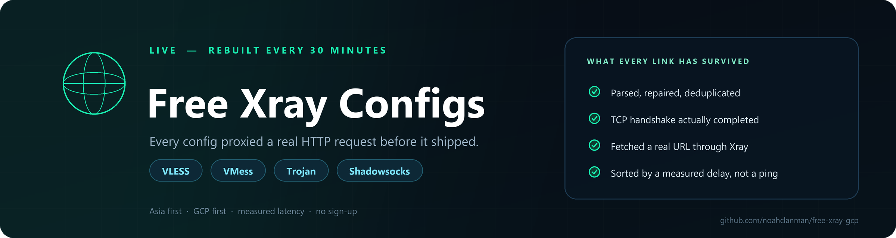
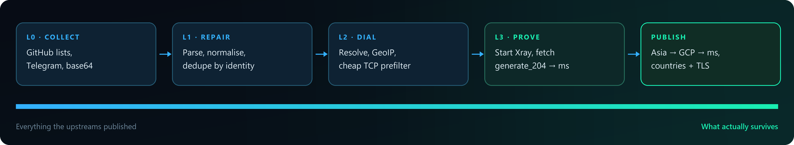

<div align="center">



<br>

<a href="https://github.com/noahclanman/free-xray-gcp/actions/workflows/update.yml"></a>

<a href="https://t.me/xray_ehi_hub"></a>


<br><br>

**Live counters — read straight from [`index.json`](https://raw.githubusercontent.com/noahclanman/free-xray-gcp/main/output/index.json) and [`health.json`](https://raw.githubusercontent.com/noahclanman/free-xray-gcp/main/output/health.json), so they cannot go stale:**


</div>

---

## 🚀 Start here — copy one line

**Top 100** is the shortest path to a working connection: the 100 fastest configs, measured through the proxy, small enough to import anywhere.

```
https://raw.githubusercontent.com/noahclanman/free-xray-gcp/main/output/top100.txt
```

**Want everything?** Same standard of proof, just longer — Asia first, then the rest:

```
https://raw.githubusercontent.com/noahclanman/free-xray-gcp/main/output/all/configs_base64.txt
```

| | | |
|---|---|---|
| **[📥 Get the links](OUTPUTS.md)**<br><sub>Every collection, protocol and transport</sub> | **[✈️ Join @xray_ehi_hub](https://t.me/xray_ehi_hub)**<br><sub>Outages, new links, support</sub> | **[⭐ Star this repo](https://github.com/noahclanman/free-xray-gcp)**<br><sub>Keeps it discoverable</sub> |

### 📱 On your phone? Point your client's scanner at one of these

<div align="center">

| Top 100 | All verified | Telegram |
|:---:|:---:|:---:|
| <a href="https://raw.githubusercontent.com/noahclanman/free-xray-gcp/main/output/top100.txt"></a> | <a href="https://raw.githubusercontent.com/noahclanman/free-xray-gcp/main/output/all/configs_base64.txt"></a> | <a href="https://t.me/xray_ehi_hub"></a> |
| **Top 100**<br><sub>The 100 fastest</sub> | **All verified**<br><sub>Scan into your client</sub> | **@xray_ehi_hub**<br><sub>Telegram channel</sub> |

<sub>Each QR encodes the subscription URL itself — your client fetches a fresh list every time, it is not a frozen snapshot.</sub>

</div>

### 📲 Import in 10 seconds

| Client | How |
|---|---|
| **v2rayNG** (Android) | `+` → *Import config from clipboard* / *Add subscription* → paste the URL |
| **v2rayN** (Windows) | *Servers* → *Import bulk URL from clipboard* → paste |
| **Hiddify** | *Add profile from link* → paste the URL |
| **Streisand / NekoBox / Shadowrocket** | Add subscription → paste the URL |

---

## 🔬 Does it actually work?

Most free-config repositories publish a big number and let you guess. Here is the uncomfortable answer, **measured rather than estimated**: the majority of any free config pool is dead at any given moment. That is a property of free configs, not of this repository — so instead of hiding it, every run measures it and sorts by it.



| Stage | The question it asks | Cost |
|---|---|---|
| **L0 Collect** | What did the 20 upstreams publish? (GitHub lists, base64 subscriptions, Telegram channels) | no network filtering |
| **L1 Repair** | Is it parsable, is the endpoint unique, is the remark safe? | no network |
| **L2 Dial** | Does the TCP port actually accept a connection? Does the IP belong to GCP? Which country? | one connect per endpoint |
| **L3 Prove** | **Start Xray with this exact config and fetch `generate_204` through it.** | up to 7 s per config |
| **Publish** | Sort Asia → GCP → latency, then split into countries, transports and protocols | local |

A config only reaches `output/` if **L3 returned HTTP 200/204 through the proxy**. There is no TCP-ping-only entry anywhere in this repository. The delay you see in the ranking is the same end-to-end request — DNS, TCP, TLS and HTTP — not a handshake.

> **Why the list is shorter than the pool:** on a typical run we collect ~42,000 links, keep ~17,000 unique, about 10,000 accept TCP, roughly 3,500 get a real Xray test inside the time budget, and ~900–1,000 pass. The rest failed, and publishing them would waste your time.

---

## 📦 What's inside

| Collection | Contents | Link |
|---|---|---|
| **All** | every verified config, Asia first | [`all/configs_base64.txt`](https://raw.githubusercontent.com/noahclanman/free-xray-gcp/main/output/all/configs_base64.txt) |
| **Top 100** | the 100 fastest | [`top100.txt`](https://raw.githubusercontent.com/noahclanman/free-xray-gcp/main/output/top100.txt) |
| **Low ping** | everything at or under 400 ms | [`fast/configs_base64.txt`](https://raw.githubusercontent.com/noahclanman/free-xray-gcp/main/output/fast/configs_base64.txt) |
| **GCP** | only configs hosted on Google Cloud | [`gcp/configs_base64.txt`](https://raw.githubusercontent.com/noahclanman/free-xray-gcp/main/output/gcp/configs_base64.txt) |
| **Protocols** | VLESS · VMess · Trojan · Shadowsocks | [`protocols/`](OUTPUTS.md#2-protocols--protocols) |
| **Transports** | `tls` · `reality` · `ws_tls` · `grpc_tls` · `xhttp_tls` · `httpupgrade_tls` · `non_tls` | [`transports/`](OUTPUTS.md#3-transports-and-security--transports) |
| **Countries** | 40+ country files, resolved from the server IP | [`Countries/`](OUTPUTS.md#4-countries--countries) |
| **Regions** | Asia, Europe, North America, South America, Africa, Oceania | [`regions/`](OUTPUTS.md#5-regions--regions) |

Every collection also exists as plain text (`configs.txt`) next to the base64 twin. The full catalogue, JSON schemas and file-by-file documentation live in **[OUTPUTS.md](OUTPUTS.md)**.

---

## 🏷️ Naming

```
JP 🇯🇵 | @xray_ehi_hub | 1d974            verified config in Japan
GCP SG 🇸🇬 | @xray_ehi_hub | 3ae49        same, but the server IP is inside Google Cloud
```

| Part | Meaning |
|---|---|
| `GCP ` | optional prefix — the resolved server IP is inside a Google Cloud range |
| `JP 🇯🇵` | country code + flag, from **GeoIP on the server IP**, not from the label the upstream gave it |
| `@xray_ehi_hub` | the channel that maintains this list — [t.me/xray_ehi_hub](https://t.me/xray_ehi_hub) |
| `1d974` | stable ID: first 5 hex chars of `sha1(server + credentials)` |

The stable ID means the same server keeps the same tag across runs, so your client keeps its selection when the list refreshes. Latency is still measured and still decides the order (`top100`, `fast/`, Asia-first sorting) — it is just not printed in the name anymore.

---

## 🌏 GCP first, honestly

All GCP candidates are tested **before** anything else, and any GCP config that fails gets a second attempt with a longer timeout. Working GCP configs go to their own folder and are always kept, even if slow.

The catch is arithmetic: of ~17,000 unique configs, usually only **around ten** resolve to a Google Cloud IP, and free ones are often dead. When none pass, `gcp/` is not published at all and `index.json` reports `categories.gcp.count: 0` — that is an honest zero, not a broken build. The folder reappears automatically the moment one survives the real test.

---

## 🔌 Sources

20 upstreams are polled on every run:

- **GitHub aggregators** — 0xRadikal, Epodonios, MhdiTaheri, mahdibland, ALIILAPRO, roosterkid, ermaozi, Pawdroid, freefq, Surfboard TGParse, Kwinshadow, ts-sf
- **Telegram channels** — `FreeV2rayConfig`, `proxy_mtm`, `v2rayngvless`, `DirectVPN` (links are scraped from their public web previews)
- plus plain text lists, base64 subscriptions and HTML pages

Add your own by editing [`sources.txt`](sources.txt) — one URL per line, `{Y}` `{M}` `{D}` `{YMD}` are replaced with the current UTC date. Push, and the workflow rebuilds automatically.

---

## 🍴 Run your own copy

```bash
git clone https://github.com/noahclanman/free-xray-gcp.git
cd free-xray-gcp
python scripts/update.py          # Python 3.9+ and Xray on PATH (or set XRAY_BIN)
```

To run it entirely on GitHub (fork → enable Actions → first run), follow **[FORK_GUIDE.md](FORK_GUIDE.md)**. It covers the write-permission setting that trips most forks, the environment variables, changing the schedule, and fixing the common failures.

| Variable | Default | Meaning |
|---|---|---|
| `XRAY_BIN` | `xray` | path to the Xray binary used for the real test |
| `MAX_OUTPUT` | `1000` | cap on published configs |
| `MAX_TEST_MINUTES` | `20` | time budget for the real test phase (CI uses 15) |
| `TEST_WORKERS` | `16` | parallel Xray instances |
| `TEST_TIMEOUT` | `7` | seconds allowed for one proxied request |
| `FAST_MS` | `400` | threshold for the `fast/` list |
| `MAX_MS` | `4000` | drop non-GCP configs slower than this (GCP ones are always kept) |
| `TCP_PREFILTER` | `1` | set `0` to send every config through Xray |
| `GCP_ONLY` | `0` | set `1` to publish GCP configs only |
| `PROTOCOLS` | `vmess,vless,trojan,ss` | protocols to keep |
| `CHANNEL` | `@xray_ehi_hub` | label printed inside every remark |
| `REPO` / `BRAND` | – | used in list headers and `index.json` |

---

## 💛 Two things keep this running

<div align="center">

| ⭐ **Star this repo** | ✈️ **Join [@xray_ehi_hub](https://t.me/xray_ehi_hub)** |
|:---:|:---:|
| GitHub ranks search and "related repositories" by stars, so one click genuinely decides whether the next person looking for a working config ever sees this page. | Outages, dead upstreams and changed links are announced **before** your client goes quiet. Questions and broken-config reports are welcome there too. |

</div>

There is no sign-up, no ad and no paywall here, and there never will be. If the project saved you an evening of hunting for a config that actually connects, you can send a tip — any amount is appreciated and a small one is completely fine.

<div align="center">

**🌐 [donate.opencfg.xyz](https://donate.opencfg.xyz/)**

| TRC20 — Tron | EVM — Ethereum · BSC · Polygon · Arbitrum · Base | TON — The Open Network |
|:---:|:---:|:---:|
| <a href="assets/qr_trc20.png"></a> | <a href="assets/qr_evm.png"></a> | <a href="assets/qr_ton.png"></a> |

</div>

**TRC20 — Tron**

```
TFwFqETTpgMr799EpDFSRYJZ3ZW2FH2Pve
```

**EVM chains — Ethereum, BSC, Polygon, Arbitrum, Base, …**

```
0x13cec186826d5cae07960a1e5947dc06cba12672
```

**TON — The Open Network**

```
UQA01GcpQ2wzqIBCJgY5thTFEBWq8g2R-3zlH8okGpIsfXnP
```

---

## ⚠️ Honest limits

- **A passing config can still die.** Servers are shared, rate-limited and disappear within hours. The list is regenerated every 30 minutes; your app keeps the last copy it downloaded.
- **Latency is measured from a GitHub datacenter**, not from your network. Use it to rank configs, not as an absolute number.
- **Free configs are not private.** Assume the operator can see your traffic metadata. Do not use them for banking, logins or anything sensitive.
- **Some networks block some servers.** A config that passes from GitHub (or from another country) may still fail for you — that is filtering, not a broken list.

## 📄 Disclaimer

For educational and research purposes. No uptime or quality guarantee — see the measured reality above, which is published precisely so that nothing here has to be taken on faith. This repository only aggregates publicly posted configuration links and tests reachability; it does not host, operate or endorse any server. Use it in accordance with the laws that apply to you.

## 📚 Documentation

| Document | Contents |
|---|---|
| [OUTPUTS.md](OUTPUTS.md) | every output file, the naming scheme, `index.json` / `health.json` schemas |
| [FORK_GUIDE.md](FORK_GUIDE.md) | run this on your own GitHub account, step by step |
| [CONTRIBUTING.md](CONTRIBUTING.md) | adding sources, reporting dead configs, PR rules |
| [SECURITY.md](SECURITY.md) | reporting a vulnerability, safe usage |
| [CODE_OF_CONDUCT.md](CODE_OF_CONDUCT.md) | how we treat each other |
| [ACCESSIBILITY.md](ACCESSIBILITY.md) | plain-language and screen-reader commitments |
| [LICENSE](LICENSE) | MIT |

---

<div align="center">
<sub>Built by <a href="https://t.me/xray_ehi_hub">@xray_ehi_hub</a> · MIT · every 30 minutes, automatically</sub>
</div>
